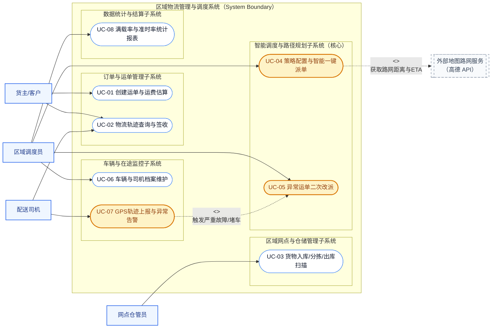

# 核心业务边界界定与用例模型

## 1. 项目背景与建设目标

随着同城即时配送与省内短途干支线物流业务量持续增长，传统依赖人工经验（Excel 排单 + 微信群派车）的区域物流运作模式面临**车货匹配效率低、车辆空驶率高、在途异常响应滞后、运单状态不透明**四大痛点。

本项目面向**单一城市或省内都市圈区域（包含 1 个区域分拨中心、若干末端配送网点与配送车队）**，设计一套高内聚、低耦合、可扩展的**区域物流管理与调度系统**，核心目标如下：
1. **业务全链路数字化**：实现电子运单从创建、揽收、分拣、派车到签收的状态机闭环管理。
2. **调度决策智能化**：支持根据业务场景动态切换调度策略（最短路径、满载率优先、加急时间窗优先），降低区域空驶里程。
3. **异常处置松耦合化**：建立在途实时监控与异常事件推送机制，支持车辆故障或严重拥堵时的快速二次改派。

---

## 2. 系统业务范围界定

为保证在有限设计周期内聚焦核心软件工程问题、避免需求蔓延，明确界定系统边界如下：

| 范围分类 | 包含 / 排除项 | 具体说明 |
| :--- | :--- | :--- |
| **范围内（In-Scope）** | 1. 订单与电子运单管理 | 客户下单、运费估算、电子运单生成、运单状态追踪与电子签收。 |
| | 2. 区域网点与仓储管理 | 分拨中心与末端网点货物入库、分拣分区、装车出库扫描与状态回写。 |
| | 3. **智能调度与路径规划（核心）** | 待派运单池管理、多约束（载重/容积/时间窗）车货匹配、调度策略切换、人工微调与异常改派。 |
| | 4. 车辆管理与在途监控 | 车辆及司机基础档案、GPS 定时位置上报、偏航/拥堵/车损异常上报与大屏告警。 |
| | 5. 运营统计与运费核算 | 车辆满载率、准时送达率等核心 KPI 统计及基础运费汇总。 |
| **范围外（Out-of-Scope）** | 1. 第三方支付清结算通道 | 仅保留运费金额计算与对账单数据结构，不接入微信/支付宝/银行真实资金清算。 |
| | 2. 跨省长途干线与多式联运 | 聚焦同城/省内区域公路货运，不涉及航空、铁路及跨国报关清关流程。 |
| | 3. 底层地图引擎与导航渲染 | 通过适配器（Adapter）调用外部地图 API（如高德/百度）获取路网耗时与距离，不自研 GIS 引擎。 |

---

## 3. 系统参与者识别

| 参与者名称 | 角色类型 | 在系统中的核心职责与交互终端 |
| :--- | :--- | :--- |
| **货主 / 客户** | 主要参与者 | 通过 Web/小程序端发起托运下单、查询实时物流轨迹、确认签收或接收延误预警通知。 |
| **区域调度员** | 主要参与者（核心） | 通过 PC 端调度大屏管理待派运单池、选择调度策略一键生成派车方案、处理车辆异常并执行二次改派。 |
| **配送司机** | 主要参与者 | 通过移动端 App/小程序接收调度任务单、确认装货发车、定时自动上报 GPS、上报在途异常及拍照签收。 |
| **网点仓管员** | 主要参与者 | 通过 PDA/Web 端执行货物到站入库扫描、按配送片区分拣货物及发车出库核验。 |
| **外部地图服务** | 外部支撑系统 | 提供地址经纬度地理编码（Geocoding）、两点间真实路网距离与实时预估通行时间（ETA）。 |

---

## 4. 系统核心用例图（Use Case Diagram）

---

## 5. 核心用例规约说明

以下挑选 3 个最能体现系统核心价值的用例编写标准用例规约，直接指导后续的数据库表设计、状态机设计与顺序图设计。

### UC-01：创建电子运单与入库分拣

* **参与者**：货主/客户、网点仓管员
* **前置条件**：客户已完成登录；收发地址处于本区域服务覆盖范围内。
* **基本事件流**：
  1. 客户填写寄件人、收件人地址、货物重量、体积、期望送达截止时间（时间窗）及是否加急。
  2. 系统校验参数合法性，调用地图服务校验地址并解析经纬度，按基础计费规则计算预估运费。
  3. 客户确认提交，系统生成唯一运单号，运单初始状态置为`待揽收`。
  4. 货物送抵分拨中心/网点后，仓管员扫码入库并完成区域分拣，运单状态更新为`待调度`，进入区域待派运单池。
* **异常/扩展流**：
  * `E1`：货物单件重量或体积超过车队单车最大承载上限 -> 系统提示需拆单处理，禁止直接进入自动调度池。
* **后置条件**：运单记录持久化至数据库，状态变更为`待调度`。

### UC-04：策略配置与智能一键派单（核心用例）

* **参与者**：区域调度员、外部地图服务
* **前置条件**：待派运单池中存在状态为`待调度`的运单，且当前区域存在状态为`空闲`的可用车辆。
* **基本事件流**：
  1. 区域调度员在调度大屏选定当前波次的调度策略（`最短路径优先` / `满载率优先` / `加急时间窗优先`），点击“生成调度方案”。
  2. 系统拉取所有`待调度`运单与`空闲`车辆，调用外部地图服务获取路网距离矩阵。
  3. 智能调度引擎执行带载重、容积及时间窗约束的派单算法，输出“车辆—运单集合—推荐配送顺序”组合方案。
  4. 调度员在界面预览各车满载率与预估完成时间，确认下发。
  5. 系统生成正式调度任务单（`DispatchTask`），锁定对应车辆状态为`待发车`，将关联运单状态批量更新为`已派车`，并通过消息队列推送任务至对应司机移动端。
* **异常/扩展流**：
  * `E1`：运力不足导致部分运单无法满足时间窗或载重约束 -> 系统将成功匹配部分生成方案，未分配运单单独高亮输出至“人工介入清单”，提示调度员申请跨网点借调或延迟至下一波次。
  * `E2`：外部地图 API 超时不可用 -> 系统降级启用本地欧氏/哈弗辛直线距离乘以城市绕行系数（如 1.35）估算路径，保证调度功能高可用。
* **后置条件**：调度任务单持久化；司机端收到新任务推送通知。

### UC-05 & UC-07：在途异常告警与二次改派（核心闭环）

* **参与者**：配送司机、区域调度员、货主/客户
* **前置条件**：车辆处于`在途运输`状态，正在执行有效调度任务。
* **基本事件流**：
  1. 司机移动端定时上报车辆 GPS 经纬度；若遇车辆故障、交通事故或严重封路，司机点击“一键上报异常”并选择异常类型。
  2. 在途监控模块捕获异常事件，向事件总线发布`VehicleExceptionEvent`。
  3. 关联运单状态转为`异常挂起`；调度大屏告警订阅者实时弹窗标红预警；客户通知订阅者向受影响运单的收寄件人发送延误提示。
  4. 调度员点击“异常改派”，系统锁定原车剩余未签收运单并释放回待派池，自动筛选距离事故点最近的空闲车辆生成救援接驳方案。
  5. 调度员确认改派，新司机收到接驳任务，原任务标记为`异常终止`，关联运单恢复流转。
* **后置条件**：异常事件留痕归档；受影响运单由接驳车辆接管继续配送。

---

## 6. 非功能性需求约束

根据软件工程系统设计原则，以下非功能指标将直接作为 `02-system-design` 阶段架构方案对比与权衡的量化依据：

1. **性能与响应时间**：
   * 常规业务查询（运单列表、轨迹查看）响应时间 $\le 500\text{ ms}$。
   * 单次区域智能派单（200 笔运单、30 辆车规模）算法计算与方案返回时间 $\le 3\text{ s}$。
   * 支持区域内 100 辆在线货车每 10 秒上报一次 GPS 的并发写入。
2. **可扩展性与可维护性**：
   * 遵循**高内聚、低耦合**与**开闭原则**：新增调度算法规则或异常通知渠道时，不应修改核心调度主流程代码。
   * 系统架构需兼顾当前中小规模区域的低运维成本，同时支持未来业务扩张至多省市时的服务平滑拆分。
3. **可靠性与数据一致性**：
   * 运单状态流转与车辆锁定必须保证事务一致性，杜绝“一单多派”或“超载派车”。
   * 车辆异常通知采用异步解耦机制，确保短信/大屏推送波动不阻塞核心运单与调度写入。