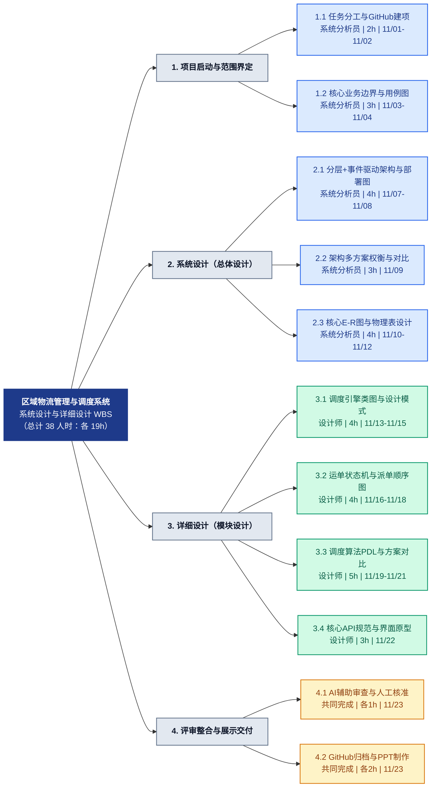
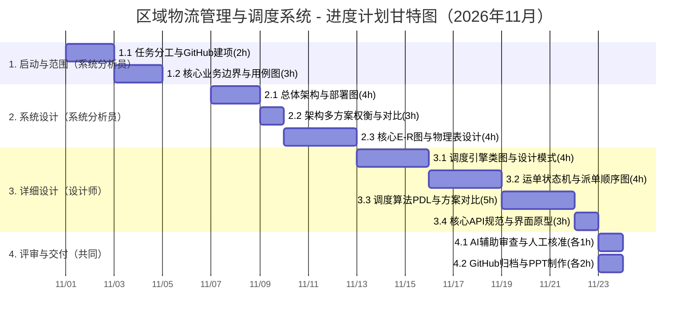

# 项目计划、WBS 工作分解与进度表

## 1. 项目基本信息

| 项目属性 | 具体内容 |
| :--- | :--- |
| **项目名称** | 区域物流管理与调度系统 |
| **实验类别** | 系统设计类和详细设计类 |
| **项目周期** | 2026-11-01 至 2026-11-23（共 23 天） |
| **团队规模** | 2 人（系统分析员 1 名、设计师 1 名） |
| **估算总工作量** | **38 h/人**（系统分析员 19 人时，设计师 19 人时） |
| **协同管理平台** | GitHub |

---

## 2. 团队角色与核心职责

| 角色 | 核心职责与负责阶段 | 预估工时 |
| :--- | :--- | :--- |
| **系统分析员**（兼轻量化进度协调） | 负责项目建项与进度追踪、业务边界与用例建模；主导**系统设计（总体设计）**，包括总体架构设计、架构多方案权衡、数据库 E-R 图与物理表设计。 | 19 h |
| **设计师**  | 主导**详细设计（模块/构件级设计）**，包括智能调度引擎类图与设计模式落地、运单状态机与核心顺序图、核心调度算法 PDL 及方案对比、RESTful API 规范与界面原型设计。 | 19 h |

---

## 3. WBS 工作分解结构（Work Breakdown Structure）

---

## 4. 详细任务分工与工时估算表

| WBS 编号 | 所属阶段 | 任务名称 | 负责人 | 起止日期 | 预估工时 | 核心交付物及归档路径 |
| :--- | :--- | :--- | :--- | :--- | :--- | :--- |
| **1.1** | 1. 项目启动与范围界定 | 任务分工与 GitHub 建项 | 系统分析员 | 11/01 - 11/02 | 2 h | GitHub 仓库与看板、`01-project-management/wbs-and-schedule.md` |
| **1.2** | 1. 项目启动与范围界定 | 核心业务边界与用例图 | 系统分析员 | 11/03 - 11/04 | 3 h | `01-project-management/use-case-and-scope.md` |
| **2.1** | 2. 系统设计（总体设计） | 分层+事件驱动架构与部署图 | 系统分析员 | 11/07 - 11/08 | 4 h | `02-system-design/architecture-design.md` |
| **2.2** | 2. 系统设计（总体设计） | 架构多方案权衡与对比 | 系统分析员 | 11/09 | 3 h | `02-system-design/architecture-tradeoff.md` |
| **2.3** | 2. 系统设计（总体设计） | 核心 E-R 图与物理表设计 | 系统分析员 | 11/10 - 11/12 | 4 h | `02-system-design/database-design.md`、`schema.sql` |
| **3.1** | 3. 详细设计（模块设计） | 调度引擎类图与设计模式 | 设计师 | 11/13 - 11/15 | 4 h | `03-detailed-design/class-and-patterns.md` |
| **3.2** | 3. 详细设计（模块设计） | 运单状态机与派单顺序图 | 设计师 | 11/16 - 11/18 | 4 h | `03-detailed-design/behavior-modeling.md` |
| **3.3** | 3. 详细设计（模块设计） | 调度算法 PDL 与方案对比 | 设计师 | 11/19 - 11/21 | 5 h | `03-detailed-design/dispatch-algorithm.md` |
| **3.4** | 3. 详细设计（模块设计） | 核心 API 规范与界面原型 | 设计师 | 11/22 | 3 h | `03-detailed-design/api-specification.md`、`ui-prototypes/` |
| **4.1** | 4. 评审整合与展示交付 | AI 辅助审查与人工核准 | 共同完成 | 11/23 | 各 1 h（共 2 h） | 边界条件核对记录、图表一致性修订 |
| **4.2** | 4. 评审整合与展示交付 | GitHub 归档与 PPT 制作 | 共同完成 | 11/23 | 各 2 h（共 4 h） | `05-presentation/logistics-design-slides.pptx`、`speech-script.md` |
| **合计** | — | **全周期共 11 项原子任务** | **2 人协同** | **11/01 - 11/23** | **38 人时** | **系统分析员 19 h + 设计师 19 h** |

---

## 5. 项目进度甘特图

---

## 6. 进度跟踪、核准与协作规范

1. **任务看板化管理**：将上述 11 项 WBS 任务拆解为 GitHub Issues，并在 GitHub Projects 看板中按 `Todo → In Progress → Review → Done` 四列流转，每项任务严格绑定负责人（Assignee）与阶段标签（Label）。
2. **关键里程碑接口对齐**：
   * **M1 里程碑（11/04）**：完成用例与业务边界冻结，确保后续设计不发生范围蔓延。
   * **M2 里程碑（11/12）**：系统分析员交付总体架构与数据库表结构，两人进行 30 分钟接口对齐，作为 11/13 启动详细设计的基线输入。
   * **M3 里程碑（11/23）**：通过精准构造 Prompt 引入 AI 辅助检查状态机死锁、类图与数据表字段一致性，经两人人工核准后完成终稿归档。
3. **动态缓冲与工时核准**：排期中在 11/05–11/06 预留了 2 天阶段缓冲期，用于应对前期范围调整或文档返工；每完成一个阶段即核对实际工时与预估工时偏差。