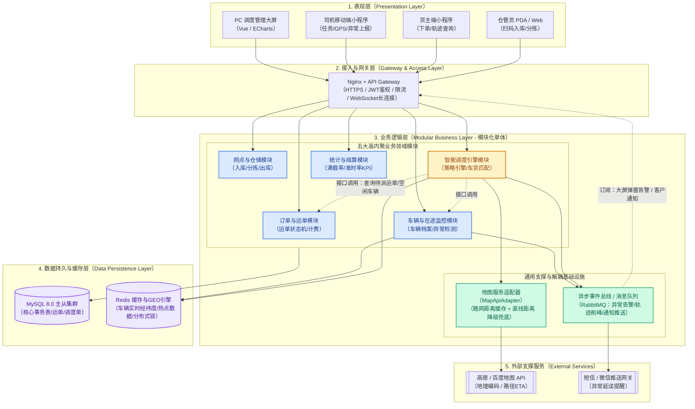
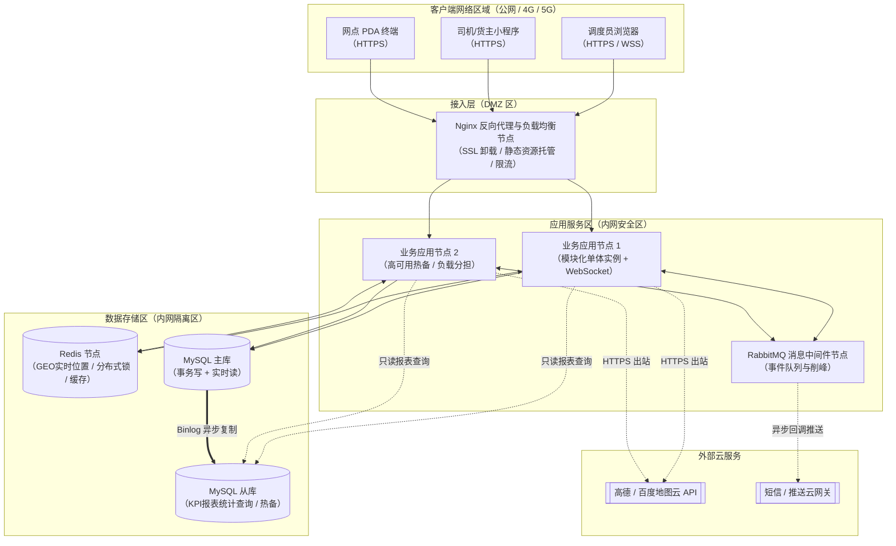

# 系统总体架构与物理部署设计

## 1. 系统设计目标与核心工程原则

依据 `01-project-management/use-case-and-scope.md` 界定的业务边界与非功能性指标（区域 200 笔运单/30 辆车 3 秒内完成调度、100 辆车 GPS 高频写入、异常快速响应），总体架构设计严格遵循软件工程以下四项核心原则：

1. **高内聚、低耦合**：按业务领域划分 5 大独立功能模块，模块内部围绕单一职责实现**功能内聚**；模块之间仅通过明确定义的内部服务接口或异步事件通信，杜绝跨模块直接读写对方数据库表。
2. **关注点分离**：采用分层体系结构，将用户交互、安全网关、业务规则与数据持久化彻底解耦，便于并行开发与单元测试。
3. **信息隐藏与外部依赖隔离**：将易变的外部地图 API（高德）与短信网关封装在独立的适配器层背后，并提供降级兜底策略，屏蔽外部接口变动与超时故障对核心调度的冲击。
4. **事件驱动解耦**：针对在途 GPS 高频轨迹与车辆故障告警，采用“发布—订阅”异步机制，避免非核心通知阻塞核心运单与派单事务。

---

## 2. 系统总体逻辑架构设计

系统采用 **“四层分层架构 + 模块化单体 + 异步事件总线”** 的混合体系结构，逻辑分层与组件交互如下：

---

## 3. 核心业务子系统划分与内聚/耦合设计

| 子系统 / 模块名称 | 核心职责（功能内聚） | 对外暴露接口（低耦合边界） | 关键数据归属 |
| :--- | :--- | :--- | :--- |
| **订单与运单管理模块** | 运单创建、运费估算、电子运单状态机校验、签收核销 | `getReadyWaybills()`, `batchUpdateStatus()`, `releaseWaybills()` | `waybill`, `sys_user` |
| **区域网点与仓储模块** | 区域分拨中心与末端网点管理、入库扫描、片区分拣、出库核验 | `getStationByZone()`, `confirmInboundSorting()` | `station` |
| **智能调度与路径规划模块** | 待派运单聚合、调度策略动态切换、约束车货匹配、异常改派生成 | `generateDispatchPlan()`, `confirmTask()`, `reassignTask()` | `dispatch_task`, `dispatch_task_waybill` |
| **车辆与在途监控模块** | 车辆/司机档案维护、GPS 坐标高频接收、偏航/车损异常事件发布 | `getAvailableVehicles()`, `lockVehicle()`, `reportException()` | `vehicle`, `tracking_log` |
| **数据统计与结算模块** | 定时汇总各车满载率、准时送达率、异常率及基础运费对账报表 | `queryDailyKpiReport()`, `exportBillingSummary()` | 只读聚合视图（不直接修改核心表） |

---

## 4. 关键架构级技术机制

1. **高并发 GPS 轨迹削峰与冷热分离**：
   * 车辆每 10 秒上报一次坐标，直接高频 `INSERT` 关系型数据库易引发锁竞争。架构设计采用 **Redis GEO 实时覆盖写（供调度大屏毫秒级拉取车辆最新点位） + RabbitMQ 异步批量消费落盘 MySQL（供历史轨迹回放）** 的冷热分离策略。
2. **车辆锁定与防“一单多派”并发控制**：
   * 当两名调度员同时点击“一键派单”或执行“异常改派”时，利用 **Redis 分布式锁（按区域网点粒度加锁） + 数据库 `version` 乐观锁** 双重校验，确保同一运单不会被重复分配给两辆车，同一车辆不会被超载锁单。
3. **外部地图服务容错与降级机制**：
   * `MapApiAdapter` 内部对常用网点与片区间的路网距离做 Redis 缓存（TTL 15 分钟），减少外部 API 调用频次；当外部地图接口超时（$> 1.5\text{ s}$）或返回限流错误时，自动降级为本地算法估算路径，保障调度主链路永不中断。

---

## 5. 系统物理部署架构设计

面向区域级物流企业的中小规模并发与高可用诉求，物理部署采用“轻量双机高可用 + 数据主从分离”方案，既控制服务器硬件成本，又消除单点故障。

### 建议部署资源规格参考

| 逻辑节点 | 节点数量 | 建议配置 | 部署职责说明 |
| :--- | :--- | :--- | :--- |
| **Nginx 网关节点** | 1 台（可扩展 Keepalived 双机） | 2 核 4G | 统一公网入口、HTTPS 证书终止、动静分离及请求转发 |
| **核心应用节点** | 2 台（双活负载均衡） | 4 核 8G / 台 | 运行区域物流模块化单体应用，承载业务 API 与实时调度算法计算 |
| **消息与缓存节点** | 1 台（容器化隔离部署） | 4 核 8G | 部署 Redis（GEO 与锁）与 RabbitMQ（轨迹削峰、异常告警队列） |
| **MySQL 数据库** | 1 主 1 从 | 4 核 16G / 台（SSD） | 主库承接核心事务写入；从库承接统计报表查询与灾备恢复 |