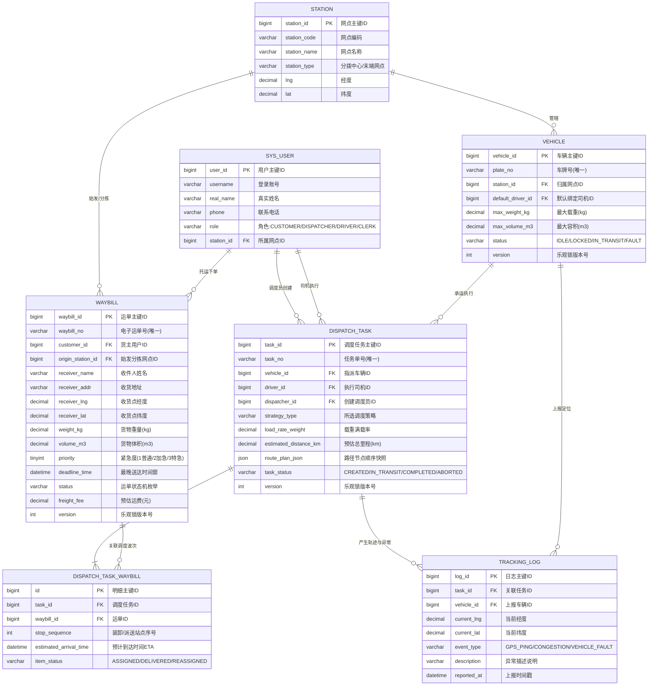

# 数据库概念设计（E-R 模型）与物理表结构设计

## 1. 数据建模核心原则

1. **规范化与适度反规范化结合**：基础实体严格遵循**第三范式（3NF）**以消除更新异常（如网点、车辆、用户独立建表）；在调度任务单中适度引入 JSON 字段存储路径规划详情快照，避免频繁多表联查拖慢大屏渲染。
2. **解决“异常二次改派”的工程级建模**：现实物流中，一笔运单可能先被分配给“任务单 1（车辆 A）”，中途车损异常挂起后又被改派给“任务单 2（救援车 B）”。因此**不能**简单地在运单表里只放一个 `task_id` 外键，而应设计**调度任务—运单关联表（`dispatch_task_waybill`）**，既完整保留历史改派轨迹，又精准记录每辆车的**配送站点顺序（`stop_sequence`）**。
3. **并发安全与数据可追溯**：核心业务表（`waybill`、`vehicle`、`dispatch_task`）统一内置 `version` 乐观锁字段，配合业务状态枚举，从数据层杜绝状态非法跃迁与并发覆盖。

---

## 2. 数据库概念模型（E-R 图）

> 核心包含 6 个业务实体与 1 个多对多调度明细关系表（共 7 张物理表），清晰表达区域物流全链路数据关联。

---

## 3. 核心物理表结构详细定义

完整的 MySQL 8.0 建表脚本见同目录下的 `schema.sql`，下方列出 4 张最核心业务表的详细字段规范（适合直接精选字段放入 PPT 展示）。

### 3.1 电子运单表（`waybill`）

| 字段名 | 数据类型 | 约束条件 | 业务含义与说明 |
| :--- | :--- | :--- | :--- |
| `waybill_id` | `BIGINT` | `PK, AUTO_INCREMENT` | 内部物理主键 |
| `waybill_no` | `VARCHAR(32)` | `UNIQUE, NOT NULL` | 对外展示的唯一电子运单号（如 `WB202611100001`） |
| `customer_id` | `BIGINT` | `FK -> sys_user(user_id)` | 下单货主 ID |
| `origin_station_id` | `BIGINT` | `FK -> station(station_id)` | 货物当前所在分拨中心/始发网点 |
| `receiver_addr` | `VARCHAR(255)` | `NOT NULL` | 收件详细地址 |
| `receiver_lng` / `lat` | `DECIMAL(10,6)` | `NOT NULL` | 地址经纬度（由地图 API 地理编码解析，供聚类算法使用） |
| `weight_kg` / `volume_m3` | `DECIMAL(8,2)` | `NOT NULL` | 货物重量（千克）与体积（立方米），调度硬约束 |
| `priority` | `TINYINT` | `NOT NULL, DEFAULT 1` | 优先级：`1`=普通，`2`=加急，`3`=冷链/特急 |
| `deadline_time` | `DATETIME` | `NOT NULL` | 客户期望最晚送达时间（时间窗硬约束） |
| `status` | `VARCHAR(24)` | `NOT NULL` | 严格对应状态机：`PENDING_PICKUP` / `SORTING` / `READY_FOR_DISPATCH` / `DISPATCHED` / `IN_TRANSIT` / `EXCEPTION_HOLD` / `OUT_FOR_DELIVERY` / `SIGNED` |
| `freight_fee` | `DECIMAL(10,2)` | `NOT NULL, DEFAULT 0.00` | 计算后的预估运费（人民币元） |
| `version` | `INT` | `NOT NULL, DEFAULT 0` | 乐观锁版本号，防止并发重复派单 |

### 3.2 车辆档案表（`vehicle`）

| 字段名 | 数据类型 | 约束条件 | 业务含义与说明 |
| :--- | :--- | :--- | :--- |
| `vehicle_id` | `BIGINT` | `PK, AUTO_INCREMENT` | 车辆主键 ID |
| `plate_no` | `VARCHAR(16)` | `UNIQUE, NOT NULL` | 车牌号（如 `鲁A·8821D`） |
| `station_id` | `BIGINT` | `FK -> station(station_id)` | 车辆归属区域网点 |
| `default_driver_id` | `BIGINT` | `FK -> sys_user(user_id)` | 默认绑定驾驶员 ID |
| `max_weight_kg` | `DECIMAL(8,2)` | `NOT NULL` | 额定最大载重（千克） |
| `max_volume_m3` | `DECIMAL(8,2)` | `NOT NULL` | 车厢最大容积（立方米） |
| `status` | `VARCHAR(20)` | `NOT NULL` | 车辆状态：`IDLE`（空闲）/ `LOCKED`（待发车）/ `IN_TRANSIT`（在途）/ `FAULT`（故障） |
| `version` | `INT` | `NOT NULL, DEFAULT 0` | 乐观锁版本号，防止双人并发锁车 |

### 3.3 调度任务单表（`dispatch_task`）

| 字段名 | 数据类型 | 约束条件 | 业务含义与说明 |
| :--- | :--- | :--- | :--- |
| `task_id` | `BIGINT` | `PK, AUTO_INCREMENT` | 调度任务主键 ID |
| `task_no` | `VARCHAR(32)` | `UNIQUE, NOT NULL` | 调度任务单号（如 `DT202611100001`） |
| `vehicle_id` | `BIGINT` | `FK -> vehicle(vehicle_id)` | 指派承运车辆 |
| `driver_id` | `BIGINT` | `FK -> sys_user(user_id)` | 实际执行司机 |
| `dispatcher_id` | `BIGINT` | `FK -> sys_user(user_id)` | 操作下发的区域调度员 |
| `strategy_type` | `VARCHAR(32)` | `NOT NULL` | 生成该方案所采用的策略：`SHORTEST_DISTANCE` / `MAX_LOAD_RATE` / `URGENT_TIME_WINDOW` |
| `load_rate_weight` | `DECIMAL(5,2)` | `NOT NULL` | 本车次载重满载率（百分比，如 `86.50`） |
| `estimated_distance_km` | `DECIMAL(8,2)` | `NOT NULL` | 预估总行驶里程（公里） |
| `route_plan_json` | `JSON` | `NULL` | 配送路径节点坐标与先后顺序快照，供大屏一键绘制路线 |
| `task_status` | `VARCHAR(20)` | `NOT NULL` | 任务状态：`CREATED` / `IN_TRANSIT` / `COMPLETED` / `ABORTED`（异常终止） |

### 3.4 调度任务—运单明细表（`dispatch_task_waybill`）

| 字段名 | 数据类型 | 约束条件 | 业务含义与说明 |
| :--- | :--- | :--- | :--- |
| `id` | `BIGINT` | `PK, AUTO_INCREMENT` | 关联明细主键 |
| `task_id` | `BIGINT` | `FK -> dispatch_task(task_id)` | 所属调度任务单 |
| `waybill_id` | `BIGINT` | `FK -> waybill(waybill_id)` | 关联电子运单 |
| `stop_sequence` | `INT` | `NOT NULL` | 算法规划的配送站点先后顺序（1, 2, 3...） |
| `estimated_arrival_time` | `DATETIME` | `NULL` | 该站点预计送达时间（ETA） |
| `item_status` | `VARCHAR(20)` | `NOT NULL` | 明细状态：`ASSIGNED`（已分配）/ `DELIVERED`（已送达）/ `REASSIGNED`（因异常已转派他车） |

---

## 4. 关键索引与 Redis 缓存结构设计

### 4.1 MySQL 高频查询复合索引
* **`idx_waybill_dispatch_pool` (`origin_station_id`, `status`, `deadline_time`)**：加速智能调度引擎按网点拉取“待调度”运单并按截止时间排序，避免全表扫描。
* **`idx_vehicle_station_status` (`station_id`, `status`)**：毫秒级筛选当前区域所有 `IDLE`（空闲）可用运力。
* **`idx_tracking_task_time` (`task_id`, `reported_at`)**：支撑按时间正序回放某次调度任务的完整 GPS 行驶轨迹与异常事件。

### 4.2 Redis 实时缓存数据结构

| Key 命名规范 | 数据结构 | 用途说明 | TTL 策略 |
| :--- | :--- | :--- | :--- |
| `logistics:geo:vehicles:{stationId}` | `GEO` | 存储区域内所有在线车辆最新经纬度，支持异常发生时按半径检索最近空闲救援车 | 随车辆下线移除 |
| `logistics:lock:dispatch:{stationId}` | `String` (`SETNX`) | 区域一键派单分布式互斥锁，防止两名调度员同时抢占同一批运单和车辆 | 10 秒自动过期 |
| `logistics:cache:map_dist:{hash}` | `String` | 缓存常用起终点间的外部地图真实路网距离与通行时间，降低外部 API 费用与延迟 | 15 分钟 |