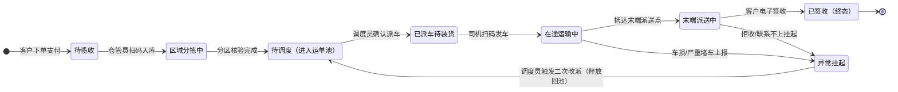
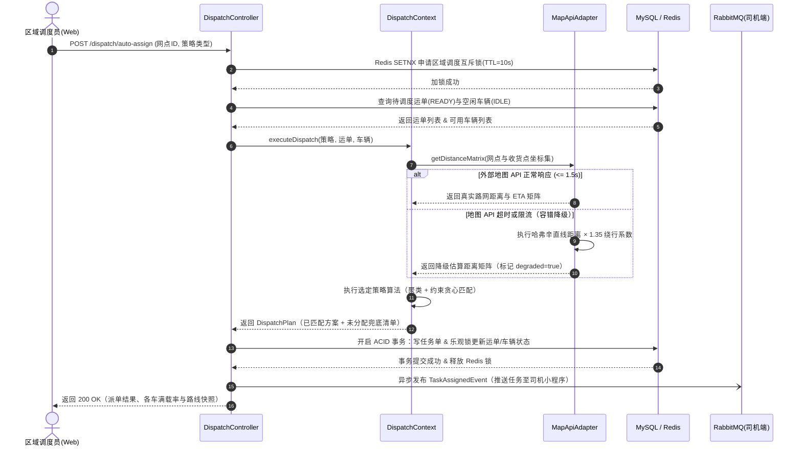

# 动态行为建模：运单状态机与核心业务顺序图

## 1. 电子运单全生命周期状态机图（State Machine Diagram）

为彻底杜绝“未分拣直接派车”、“已签收运单被重复改派”等业务数据错乱，系统对 `waybill.status` 字段建立严格的状态机守卫，并完整刻画了**在途异常挂起 → 释放运力 → 二次改派**的工程闭环。

### 非法状态跃迁拦截规则（状态守卫表）

| 当前状态 | 禁止的非法操作 | 系统拦截策略与错误码 |
| :--- | :--- | :--- |
| `PENDING_PICKUP` / `SORTING` | 直接纳入智能一键派单 | 仅拉取 `status = READY_FOR_DISPATCH` 的运单，接口层直接过滤 |
| `DISPATCHED` / `IN_TRANSIT` | 另一名调度员再次将其派给其他车辆 | 依托 Redis 锁 + `waybill.version` 乐观锁拦截，返回 `40901 运单状态已变更` |
| `SIGNED` | 触发异常挂起或二次改派 | 状态机判定为终态不可逆，返回 `40005 已签收运单不允许变更状态` |

---

## 2. 核心业务顺序图：智能一键派单与地图降级流程

本顺序图对应核心用例 `UC-04`，完整展示调度员触发派单后，从**分布式加锁、外部地图超时降级、策略引擎求解、乐观锁事务提交**到**异步推送司机端**的全链路交互。

---

## 3. 异常场景交互说明（二次改派链路）

当在途司机通过移动端调用异常上报接口时，系统执行**异步解耦 + 空间就近救援**两步闭环：
1. **同步写入 + 异步广播**：`VehicleMonitorSubject` 写入 `tracking_log` 后，将异常事件投递至 RabbitMQ；三个观察者并发完成“未签收运单置为 `EXCEPTION_HOLD`”、“WebSocket 推红框告警至调度大屏”、“异步短信通知受影响货主”。
2. **就近救援改派**：调度员在大屏点击“一键改派”时，系统调用 Redis `GEORADIUS` 指令检索事故经纬度周边 $10\text{ km}$ 内的 `IDLE` 空闲车辆，自动复用 `UrgentTimeWindowStrategy` 生成接驳任务单，并在 `dispatch_task_waybill` 中将原明细标记为 `REASSIGNED`、插入新任务明细，实现历史全程可追溯。