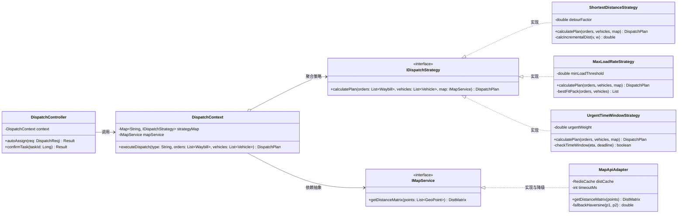
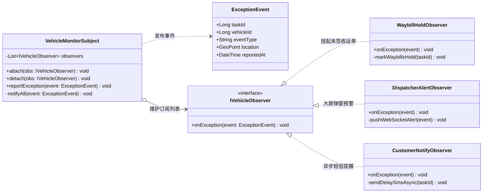

<<<<<<< HEAD
# 核心调度引擎详细类图与设计模式落地

## 1. 模块级详细设计原则

依据系统设计阶段划定的模块边界，详细设计聚焦最具业务复杂度与变化频率的**智能调度引擎模块**与**在途异常监控模块**，严格遵循以下面向对象设计（OOD）原则：

1. **开闭原则（OCP）与信息隐藏**：区域物流的派单规则常随业务周期调整（平时追求满载省油、大促追求最短里程、冷链追求时效优先）。通过**策略模式**将算法实现隐藏在统一接口后，新增规则只需新增实现类，无需修改调度主流程。
2. **松耦合事件联动**：车辆在途发生故障或严重拥堵时，需同时触发“运单状态挂起、调度大屏标红弹窗、货主延误通知”三项联动。通过**观察者模式**（结合 RabbitMQ 异步事件）将监控主题与各下游订阅者彻底解耦。
3. **依赖倒置原则（DIP）**：调度算法不直接依赖某家地图厂商的 SDK，而是依赖抽象接口 `IMapService`，由适配器完成外部调用与超时降级。

---

## 2. 核心类图一：智能调度引擎（策略模式 + 适配器模式）

> **设计亮点**：`DispatchContext` 持有抽象接口 `IDispatchStrategy`，运行时根据调度员前端所选策略动态切换；通过 `IMapService` 隔离高德地图 API 依赖，内置直线距离降级计算。

---

## 3. 核心类图二：在途异常联动机制（观察者模式）

> **设计亮点**：当司机端上报车辆故障（`VEHICLE_FAULT`）或严重拥堵（`CONGESTION`）时，`VehicleMonitorSubject` 仅负责广播 `ExceptionEvent`，各观察者按职责独立响应，新增“微信机器人告警”或“保险理赔推送”时无需改动监控核心代码。

---

## 4. 核心类与方法职责规约表

| 类 / 接口名 | 所属模式 / 角色 | 核心方法签名 | 职责与边界约束说明 |
| :--- | :--- | :--- | :--- |
| `DispatchContext` | 策略上下文（Context） | `executeDispatch(type, orders, vehicles)` | 负责加分布式锁、校验空数据、按 `strategy_type` 路由具体策略并汇总未分配运单 |
| `IDispatchStrategy` | 抽象策略（Strategy） | `calculatePlan(orders, vehicles, map)` | 统一派单计算契约，屏蔽不同业务优化目标的内部算法差异 |
| `MapApiAdapter` | 适配器（Adapter） | `getDistanceMatrix(points)` | 优先查 Redis 15 分钟路网缓存；未命中则调外部地图 API；超时 $>1.5\text{ s}$ 自动调用 `fallbackHaversine` 降级 |
| `VehicleMonitorSubject` | 监控主题（Subject） | `reportException(event)` | 接收司机端异常上报，持久化 `tracking_log` 并通过异步队列通知所有观察者 |
=======
# 核心调度引擎详细类图与设计模式落地

## 1. 模块级详细设计原则

依据系统设计阶段划定的模块边界，详细设计聚焦最具业务复杂度与变化频率的**智能调度引擎模块**与**在途异常监控模块**，严格遵循以下面向对象设计（OOD）原则：

1. **开闭原则（OCP）与信息隐藏**：区域物流的派单规则常随业务周期调整（平时追求满载省油、大促追求最短里程、冷链追求时效优先）。通过**策略模式**将算法实现隐藏在统一接口后，新增规则只需新增实现类，无需修改调度主流程。
2. **松耦合事件联动**：车辆在途发生故障或严重拥堵时，需同时触发“运单状态挂起、调度大屏标红弹窗、货主延误通知”三项联动。通过**观察者模式**（结合 RabbitMQ 异步事件）将监控主题与各下游订阅者彻底解耦。
3. **依赖倒置原则（DIP）**：调度算法不直接依赖某家地图厂商的 SDK，而是依赖抽象接口 `IMapService`，由适配器完成外部调用与超时降级。

---

## 2. 核心类图一：智能调度引擎（策略模式 + 适配器模式）

> **设计亮点**：`DispatchContext` 持有抽象接口 `IDispatchStrategy`，运行时根据调度员前端所选策略动态切换；通过 `IMapService` 隔离高德地图 API 依赖，内置直线距离降级计算。

---

## 3. 核心类图二：在途异常联动机制（观察者模式）

> **设计亮点**：当司机端上报车辆故障（`VEHICLE_FAULT`）或严重拥堵（`CONGESTION`）时，`VehicleMonitorSubject` 仅负责广播 `ExceptionEvent`，各观察者按职责独立响应，新增“微信机器人告警”或“保险理赔推送”时无需改动监控核心代码。

---

## 4. 核心类与方法职责规约表

| 类 / 接口名 | 所属模式 / 角色 | 核心方法签名 | 职责与边界约束说明 |
| :--- | :--- | :--- | :--- |
| `DispatchContext` | 策略上下文（Context） | `executeDispatch(type, orders, vehicles)` | 负责加分布式锁、校验空数据、按 `strategy_type` 路由具体策略并汇总未分配运单 |
| `IDispatchStrategy` | 抽象策略（Strategy） | `calculatePlan(orders, vehicles, map)` | 统一派单计算契约，屏蔽不同业务优化目标的内部算法差异 |
| `MapApiAdapter` | 适配器（Adapter） | `getDistanceMatrix(points)` | 优先查 Redis 15 分钟路网缓存；未命中则调外部地图 API；超时 $>1.5\text{ s}$ 自动调用 `fallbackHaversine` 降级 |
| `VehicleMonitorSubject` | 监控主题（Subject） | `reportException(event)` | 接收司机端异常上报，持久化 `tracking_log` 并通过异步队列通知所有观察者 |
>>>>>>> dfb12ef849c8c4f10729f8451e0ccca61f8520ce
| `WaybillHoldObserver` | 具体观察者（Observer） | `onException(event)` | 将异常车辆尚未签收的关联运单批量转为 `EXCEPTION_HOLD`，释放二次改派资格 |